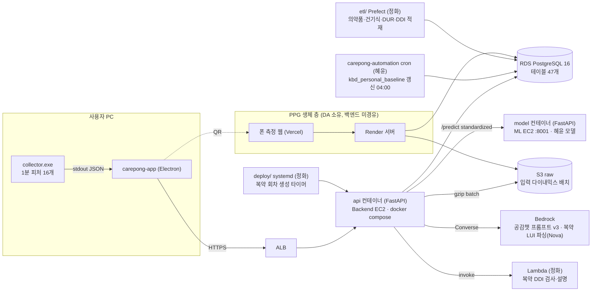

# 케어퐁 서버 구성도 — 2026-11-13

## 요청 한 번의 길 (`POST /v1/windows`)

1. 앱이 1분 창 피처 16개를 `X-User-Id` 와 함께 보낸다.
2. `services/kbd_personalize` 가 RDS 에서 직전 30분 창·전체 시드·개인 기준선을 읽어 shrinkage z-벡터를 만든다 (없으면 원시 피처).
3. `services/model_client` 가 model `/predict` 에 `standardized: true/false` 로 보낸다. 모델은 `/health` 에 `standardized_input: true` 가 있을 때만 표준화 입력을 받는다 (없으면 api 가 자동 폴백).
4. `services/policy` 가 과부하 팝업 여부를 정한다 (메모리 상태, 워커 1개).
5. `windows` 에 저장 (`model_version` 에 `+kbd` 접미면 개인화 판정). 응답은 `condition_score`·`prompt`·`prompt_type`.

## 배포 단위

| 어디 | 무엇 | 어떻게 |
|---|---|---|
| Backend EC2 | api 컨테이너 1개 (`infra/docker-compose.yml` + `docker-compose.aws.yml`) | `scripts/deploy_api_paste.txt` (git merge → compose up --build) |
| ML EC2 | model 컨테이너 | `scripts/ml_ec2_model_update_paste.txt` 로 확인 후 재빌드 |
| RDS | `api/migrations` 는 api 기동 시 자동 적용. 정화 테이블은 정화 파이프라인 | — |
| Lambda | 정화 | 정화 |
| Render/Vercel | DA | 혜윤·채원 |

## 운영 메모

- ALB idle timeout 기본 60초. 복약 LUI confirm 은 서버가 DDI Lambda 를 40초까지 기다리므로 앱 타임아웃 60초.
- EC2 재부팅 시 api 는 `restart: always` 로 자동 기동 (10/12).
